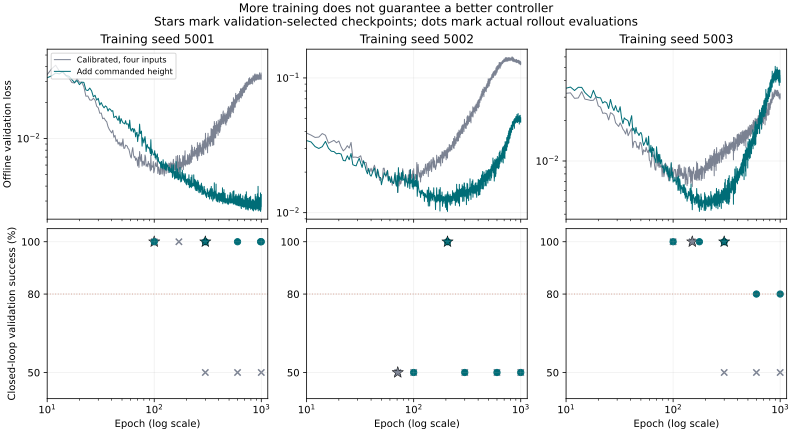

# Reach training diagnosis and repair (5.2A)

Status: complete September 17, 2026, after owner acceptance of the reach review
and explicit authorization to complete, commit and push. This document records
remediation after the preserved negative 5.2 experiment. The three selected V5
models pass the bounded state-grounded reach gate. No perception qualification
or other skill implementation is claimed. The original
`configs/level5/SHA256SUMS` protocol and releases remain unchanged. Experiments
below use separately checksum-locked repair recipes. The later owner acceptance
record is `docs/level5_reach_acceptance.json`; historical receipts are unchanged.

## Why more epochs alone was insufficient

The original trainer stopped after 20 epochs without improved offline validation
loss, subject to a 100-epoch cap. That loss measures predictions on recorded
expert states. It does not measure whether the policy can recover from its own
state errors during execution. Original baseline seeds stopped at epochs
30, 23, and 23; the reference seeds at 100, 23, and 26.

The repair comparison disables that early stop and executes all 100 epochs,
retaining epochs 10, 30, 100 and the best offline checkpoint. Closed-loop
validation selects the checkpoint. More epochs are an experiment, not an
assumption that additional optimization repairs an unsuitable representation.

## Measured causes

All measurements here use training data or original validation trajectories.
The original test results are already known and are not untouched evidence.

- The reach training slice has 1,839 frames from 80 episodes. Validation has
  777 frames from 32 episodes. All 23 nontranslation target channels are exactly
  zero in both slices. The baseline nevertheless learns rotation and wrist
  increments, whose small prediction errors accumulate into absolute targets.
  Every selected baseline validation attempt terminates on `rh_A_WRJ2`.
- Training standard deviation for `robot.rotation6d.4` is approximately
  `8.205477788271441e-6`. Selected baseline validation trajectories reach
  deviations of approximately 324, 5,139 and 2,644 training standard deviations.
  Dividing a slightly shifted physical state by a nearly zero empirical scale
  magnifies the shift enormously. Some fixture position features are already
  41.9 training standard deviations from the mean at reset.
- The 192-value input includes absolute poses and entity class fields that are
  unnecessary for choosing the direction of a reach. A model can fit the
  training paths while extrapolating in the wrong direction at a new target.
- The experts execute lift, planar travel, and lowering. Planar deltas are
  exactly aligned with the remaining planar goal vector: maximum tangential
  residual in training is `1.452830911130576e-17 m`. Radial progress is
  nonnegative, never exceeds the remaining distance (roundoff
  `1.734723475976807e-18 m`), and reaches at most `0.010000000000000018 m`
  per action. There are 944 zero-planar-motion frames. A free Cartesian head
  has to rediscover this structure and can violate it away from expert states.

## Preserved v1 repair comparison

Recipe: `configs/level5/reach_repair_v1.yaml`. Seed 5001, 100 epochs each,
30 nominal validation resets per candidate. These screens cannot qualify a
policy. No confirmation data were used.

| Representation | Epochs screened | Success at epoch 100 | Best screened result |
|---|---|---:|---|
| Full 192 inputs, fixed physical scales | 10, 30, 36, 100 | 0/30 | No passing candidate |
| Full inputs, fixed scales, invariant action channels held | 10, 30, 34, 100 | 0/30 | Epoch 30: zero safety violations, but 0/30 success |
| Six goal-error/tracking-lag inputs, invariant channels held | 10, 19, 30, 100 | 15/30 | All four epochs: 15/30 successes and 15 workspace failures |

The relative representation succeeds on all 15 setup-slot resets and fails on
all 15 start-button resets. At epoch 100 the first failing reset asks to move
from `[-0.16, 0, 0.21]` toward approximately
`[-0.04150, -0.12128, 0.16445]`, yet the first predicted translation has
negative x, positive y and positive z. Training longer does not correct the
wrong direction. All 360 attempted v1 repair screening trajectories remain
under `outputs/level5/reach_repair/`; no failed run was overwritten.

## V2 hypothesis: learn movement in a goal-aligned planar frame

Recipe: `configs/level5/reach_repair_v2.yaml`, frozen after the v1 validation
findings and before v2 rollout outcomes. Keep the same two 128-unit ReLU layers,
optimizer, training ownership, balanced sampling, and 100-epoch budget.

The four inputs are planar goal distance, vertical goal error, radial measured
tracking lag, and vertical measured tracking lag, using fixed 0.1 m scales.
The learned outputs are a planar step fraction and a vertical delta. The
adapter maps the planar fraction onto the goal direction and limits it to
`[0, 1]` of the smaller of remaining distance and the declared 0.025 m step cap.
Vertical movement and its timing remain learned. Rotation and joints hold their
previous values because the training targets prove those deltas invariant.

This is an explicit geometry constraint in the policy's action representation.
It is not an unconstrained Cartesian MLP claim. There is no scripted expert,
trajectory playback, or goal-servo fallback at inference: a zero-output network
produces no movement. Raw decoded actions still face the original safety checks;
violations remain failures. The training loader rejects demonstrations that
violate the declared planar invariants instead of silently projecting them.

## Evaluation and remaining gates

Each retained candidate must receive the complete original validation matrix
before checkpoint selection. All three seeds must satisfy the unchanged
success, worst-group, jerk, and zero-safety gates. Only then may the selected
method receive its one fresh confirmation evaluation per seed.

Sixty confirmation resets (20 each for the original held-out cuboid, cylinder,
and flat-puck families, half nominal and half boundary) were frozen before
method selection. All four condition labels execute independently, giving 240
attempts per seed. They are fresh reset seeds, **not unseen task families**:
the original 5.2 experiment already evaluated those families. State inputs do
not test perception robustness under the render-only labels.

The original reach success metric uses the commanded mocap pose; measured
free-joint pose can lag. Preserve that caveat and inspect saved physical states
before making a physical reach claim. No manual acceptance is inferred from
numerical gates.

## Guidance for later skills

Before training a later skill, audit target variation, near-constant input
scales, causal phase labels, and feedback errors. Evaluate closed-loop behavior
at predetermined checkpoints; do not stop solely because demonstration loss
plateaus when rollout performance has not been established.

V2 was insufficient. V5 passes the automated repair gates documented below.
Do not copy its fixed orientation, invariant joints, or planar direction
constraint into grasping, contact, obstacle avoidance, or placement. Each skill
needs its own training-data evidence and versioned observation/action contract.
The current experiments do not authorize training those later skills.

## V2 outcome and V3 coordinate correction

All four V2 candidates (10, 25, 30, 100) retain the same 15/30 screening success
and 15 workspace failures. Planar direction improves, but vertical lift repeats
until the upper z bound is crossed. No confirmation rollouts ran for V2.

Inspection exposed a coordinate error in the repair's original tracking-lag
calculation: the freejoint describes `rh_forearm`, while the command describes
`dexvision_hand_base_target`. They are related by the frozen weld
`relpose = [-0.33701, 0, 0.045, 0.7071067811865476, 0, 0.7071067811865476, 0]`.
The original empirical feature layout is preserved; the V3 repair explicitly
converts measured forearm pose into the equivalent command-body pose before
subtracting positions. It rotates the offset using the measured orientation,
so a genuine tracking error remains measurable. The recipe verifies its
transform against the checksum-verified model XML instead of fitting an offset
from validation or test outcomes.

`configs/level5/reach_repair_v3.yaml` freezes this correction before V3 rollouts.
The same goal-plane network, target representation, training ownership,
optimizer, budget and acceptance gates remain in force. V2 artifacts are retained.

## Reproduction commands

Run from the repository root in `dexvision`. Existing run/cache/evaluation
paths are immutable: use a new output directory to reproduce an experiment;
`--resume` is only for an interrupted run with exactly matching inputs.

Prepare the checksum-verified training/validation cache (the session's existing
cache is `outputs/level5/reach_repair/diagnosis_v1`):

```bash
conda activate dexvision
python -m dexvision.apps.repair_reach prepare \
  --config configs/level5/reach_repair_v3.yaml \
  --release-root outputs/level4/manual_release_v1/restored \
  --output-dir outputs/level5/reach_repair/reproduction_cache
```

The actual V3 training/validation commands used the existing cache and paths
below, for each of seeds 5001, 5002 and 5003:

```bash
OMP_NUM_THREADS=1 MKL_NUM_THREADS=1 python -m dexvision.apps.repair_reach train \
  --config configs/level5/reach_repair_v3.yaml \
  --cache-dir outputs/level5/reach_repair/diagnosis_v1 \
  --arm goal_plane_calibrated_hold --seed 5001 \
  --output-dir outputs/level5/reach_repair/goal_plane_calibrated_hold/seed_5001/run_v3
python -m dexvision.apps.repair_reach validate \
  --config configs/level5/reach_repair_v3.yaml \
  --run-dir outputs/level5/reach_repair/goal_plane_calibrated_hold/seed_5001/run_v3 \
  --release-root outputs/level4/manual_release_v1/restored \
  --output-dir outputs/level5/reach_repair/goal_plane_calibrated_hold/seed_5001/run_v3/validation
```

On Windows, set `OMP_NUM_THREADS` and `MKL_NUM_THREADS` in the shell environment
before the same `python -m` commands. The implementation uses pathlib and
contains no local absolute paths.

The screening command replaces `validate` with `screen` and uses a separate
`screen` output directory. V1 used `physical_scale`, `physical_scale_hold`, and
`relative_goal_hold`, all seed 5001, `reach_repair_v1.yaml`, `run_v1`; V2 used
`goal_plane_hold`, seed 5001, `reach_repair_v2.yaml`, `run_v2`. All runs executed
100 epochs. Each version froze its confirmation reset metadata before selecting
or evaluating that method:

```bash
python -m dexvision.apps.repair_reach freeze-confirmation \
  --config configs/level5/reach_repair_v3.yaml \
  --release-root outputs/level4/manual_release_v1/restored \
  --output-dir outputs/level5/reach_repair/confirmation_v3
python -m dexvision.apps.repair_reach select-method \
  --config configs/level5/reach_repair_v3.yaml \
  --screen-dirs outputs/level5/reach_repair/goal_plane_calibrated_hold/seed_5001/run_v3/screen \
  --confirmation-dir outputs/level5/reach_repair/confirmation_v3 \
  --output-dir outputs/level5/reach_repair/method_selection_v3
```

Automated checks:

```bash
conda run -n dexvision pytest -q tests/test_reach_repair.py tests/test_reach_skill_training.py tests/test_reach_skill_rollout.py
conda run -n dexvision pytest -q
conda run -n dexvision ruff check .
shasum -a 256 -c configs/level5/SHA256SUMS
git diff --check
```

## V3 full validation and the stopping-budget amendment

Each candidate below received all 120 validation attempts. Seed 5001's
30-reset screen also covered all four of its candidate epochs.

| Seed | Early epochs | Late epochs | Selected epoch | Selected success | Selected safety violations |
|---|---|---|---:|---:|---:|
| 5001 | 10/30: 50% | 99/100: 100% | 100 | 120/120 | 0 |
| 5002 | 10/30: 50% | 71/100: 50% | 71 | 60/120 | 60 |
| 5003 | 10/30: 50% | 91/100: 100% | 91 | 120/120 | 0 |

The passing selected policies have mean normalized action jerk
0.009764940965187248 and 0.00857165963780178, below the unchanged
0.023869737935163705 limit. An independent saved-state check of seed 5001's
120 epoch-100 validation attempts also passes physical pose and five-sample
dwell in all 120, with maximum final measured distance 0.013101374697789677 m.
This is physical pose evidence, not manual viewer acceptance.

The seed-5002 failure prevents confirmation and qualification. No confirmation
rollouts were attempted for V1, V2 or V3. V4 freezes a 1,000-epoch budget with
candidates at 100/300/600/1,000 plus best offline. The optimizer, data, calibrated
features and action representation remain identical. There is no scheduler,
so the first 100 epochs have the same optimization schedule. The recipe,
`configs/level5/reach_repair_v4.yaml`, was frozen before V4 evaluation outcomes.
The question is whether more updates make this method reliable across seeds,
not whether an unsafe policy can be accepted under looser thresholds.

The tracked `prepare` command was also run against the verified restored
release. All 12 arrays (train/validation features, targets, masks, prior actions,
episode ids and cell ids), plus normalization metadata, exactly match the
initial diagnostic cache. The release archive SHA-256 and all frozen Level 5
plan/config hashes pass again.

## V4 budget result and V5 observation hypothesis

All three seeds complete 1,000 epochs (8,000 optimizer updates). Epoch-100
weights and sampling digests are bitwise identical to the V3 counterparts,
so the budget comparison preserves the early optimization trajectory.

Full validation retains five candidates and 600 attempts per seed. Seed 5002
still fails all retained candidates, including epochs 300, 600 and 1,000.
Seeds 5001 and 5003 have passing early/best-offline candidates but regress to
50% success at epochs 300, 600 and 1,000. V4 does not qualify and never receives
confirmation evaluation. More epochs alone do not repair vertical extrapolation;
retaining a passing earlier checkpoint is essential.

Training planar goal distance spans 0–0.14659951 m; validation extends to
0.17164235 m. The remaining failures are vertical workspace exits on the longer
start-button reaches. A second observation issue is that relative goal error
and lag omit the commanded height, which distinguishes the expert's lift,
travel and lowering stages. Two states can have identical four relative inputs
but different absolute heights and require different stage behavior.

V5 (`configs/level5/reach_repair_v5.yaml`) adds the previous applied command's
height as a fifth fixed-scale input. It preserves the V4 1,000-epoch budget,
optimizer, geometry decoder, frame calibration and candidate schedule. This
is an observation hypothesis, not a claim that height alone is sufficient;
all three validation and subsequent confirmation gates still apply.

The first full regression run found one configuration-discovery test failure
(761 passed, one skipped): it assumed every YAML file below `configs/level5`
was part of the completed 5.0 lock. The amended test verifies all independently
locked repair recipes as well as the original unchanged lock. Its targeted
rerun passes. The subsequent full suite passes **763 tests, one skipped in
615.69 seconds**. The skip is the existing platform-dependent offscreen OpenGL
check. Repository-wide Ruff and whitespace checks also pass.


## Final V5 learning method

V5 is supervised behavior cloning from deterministic scripted expert actions.
The frozen reach slice supplies 80 training episodes / 1,839 frames and 32
validation episodes / 777 frames. Whole-episode/session/cell split ownership
is preserved. Neither confirmation examples nor their outcomes fit the model.

The unchanged 192-field causal source record is reduced to five inputs:
planar distance from the previous applied command to the approach goal,
signed vertical goal error, radial tracking lag, vertical tracking lag, and
previous applied command height. Measured pose is converted through the frozen
weld transform before computing lag. Each input uses a fixed 0.1 m scale.

The PyTorch `SkillMLP` architecture is:

```text
5 inputs -> Linear(128) / ReLU -> Linear(128) / ReLU -> bounded heads
```

The original heads retain widths 3, 3, 2 and 18: 26 network outputs in total.
Only the first two coordinates have supervised loss and affect the action:
planar step fraction and vertical delta divided by 0.025 m. The remaining 24
coordinates are masked and ignored. This is effectively two learned controls,
not a newly implemented two-output head or learned full-hand articulation.

For planar distance `d`, unit direction toward the goal `u`, and the first two
tanh outputs `a` and `b`, the decoder applies:

```text
delta_xy = max(0, a) * min(d, 0.025 m) * u
delta_z  = b * 0.025 m
```

At zero planar distance, planar movement is zero. The expert targets must
satisfy the declared goal-alignment and no-overshoot constraints; invalid
targets are rejected. Direction, bounds, fixed orientation/joints and safety
logic are engineered. Progress fraction and vertical movement/timing are
learned. Zero network output holds position; there is no expert fallback.

Training uses masked mean squared error on the two active targets, Adam with
learning rate 0.001, batch size 256 and gradient norm clipping at 1.0. There is
no scheduler or weight decay. Sampling selects a cell, an episode and an
eligible frame uniformly at each stage, with replacement. Each of seeds
5001/5002/5003 runs 1,000 epochs (8,000 optimizer updates) on CPU. Offline-loss
patience does not terminate these runs. Retained candidates are epochs
100/300/600/1,000 plus the best offline validation epoch; full closed-loop
validation selects the deployed snapshot before fresh confirmation.

At runtime, current measured state, the prior applied command and the typed
goal feed the feature transform, MLP and decoder. The original raw-action
safety checks run before simulation advances. This repeats every 0.034 s
(17 MuJoCo steps, approximately 29.4 control samples/s). Weights stay fixed;
there is no RGB input, recurrent memory, reinforcement learning, online
training or demonstration playback. Later skills need their own representation
and action-variation evidence before adopting any reach-specific constraint.

## Verified V5 result — owner accepted

Each seed trained for 1,000 epochs. Every retained candidate received the full
120-attempt validation matrix: 15 candidates, 1,800 validation attempts total.
Selection uses safety, success, worst-cell success, terminal error, offline
loss and epoch in the original order. Later training snapshots remain preserved,
including regressions. Use **selected.pt**, never assume last.pt is the best
controller.

| Seed | Selected epoch | Validation success | Fresh confirmation success | Worst family | Confirmation jerk | Maximum final measured error |
|---|---:|---:|---:|---:|---:|---:|
| 5001 | 300 | 120/120 | 240/240 | 100% | 0.011491653 | 13.956 mm |
| 5002 | 207 | 120/120 | 240/240 | 100% | 0.009729653 | 14.595 mm |
| 5003 | 300 | 120/120 | 240/240 | 100% | 0.009885114 | 13.223 mm |

All three satisfy the original 80% aggregate, 65% worst-family,
0.023869737935163705 jerk and zero-safety gates. All 720 confirmation attempts
have zero invalid actions, workspace exits, actuator target-limit violations
and object workspace exits. They also independently pass physical pose and
five-sample dwell when recomputed from saved forearm states in the command
frame. There are no commanded-success cases lacking measured pose/dwell.

The 720 attempts represent 60 fresh reset identities shared across three
training seeds and four condition labels. The labels do not vary physics or
state inputs. The task families were evaluated in the original failed 5.2
experiment; this is fresh-reset evidence, with that prior family exposure
explicitly disclosed. No confirmation outcome selected or retuned V5.

Replaying the old 20-epoch loss-patience rule on V5's saved curves would stop
seed 5002 at epoch **91**, before its verified passing checkpoint at **207**.
Conversely, its epoch-1,000 checkpoint fails. Training duration and checkpoint
choice are separate decisions: let the preregistered experiment run, then use
closed-loop validation to select the controller. Loss alone is insufficient.



Independent readback verifies all 720 result records, trajectory lengths,
finite states/actions, raw action bounds, invariant outputs, timestamps,
recomputed jerk and file hashes. It also verifies all preserved V1–V4 run
artifacts. The receipt is
`outputs/level5/reach_repair/final_audit_v5/receipt.json`; per-seed physical
receipts are under `outputs/level5/reach_repair/physical_audit_v5/`.
No physics or confirmation attempt was rerun for these audits.

### V5 commands executed

The V3 command forms above were also executed with `reach_repair_v4.yaml`,
`run_v4`, and their matching confirmation/selection directories. V5 uses
`reach_repair_v5.yaml`, arm `goal_plane_height_hold`, `run_v5`, and all three
seeds. Its exact training and evaluation loop is:

```bash
conda activate dexvision
for seed in 5001 5002 5003; do
  OMP_NUM_THREADS=1 MKL_NUM_THREADS=1 python -m dexvision.apps.repair_reach train \
    --config configs/level5/reach_repair_v5.yaml \
    --cache-dir outputs/level5/reach_repair/diagnosis_v1 \
    --arm goal_plane_height_hold --seed "$seed" \
    --output-dir "outputs/level5/reach_repair/goal_plane_height_hold/seed_$seed/run_v5"
  python -m dexvision.apps.repair_reach validate \
    --config configs/level5/reach_repair_v5.yaml \
    --run-dir "outputs/level5/reach_repair/goal_plane_height_hold/seed_$seed/run_v5" \
    --release-root outputs/level4/manual_release_v1/restored \
    --output-dir "outputs/level5/reach_repair/goal_plane_height_hold/seed_$seed/run_v5/validation"
done
```

Before method selection, `freeze-confirmation` saved `confirmation_v5`,
seed 5001's `screen` evaluated every candidate, and `select-method` bound
`method_selection_v5` to that screen and reset manifest, using the command
forms above with the V5 paths. After all three validation selections passed,
these commands ran exactly once per seed:

```bash
for seed in 5001 5002 5003; do
  python -m dexvision.apps.repair_reach confirm \
    --config configs/level5/reach_repair_v5.yaml \
    --run-dir "outputs/level5/reach_repair/goal_plane_height_hold/seed_$seed/run_v5" \
    --confirmation-dir outputs/level5/reach_repair/confirmation_v5 \
    --decision-dir outputs/level5/reach_repair/method_selection_v5 \
    --output-dir "outputs/level5/reach_repair/goal_plane_height_hold/seed_$seed/run_v5/confirmation"
  python -m dexvision.apps.repair_reach audit \
    --config configs/level5/reach_repair_v5.yaml \
    --run-dir "outputs/level5/reach_repair/goal_plane_height_hold/seed_$seed/run_v5" \
    --confirmation-dir outputs/level5/reach_repair/confirmation_v5 \
    --output-dir "outputs/level5/reach_repair/physical_audit_v5/seed_$seed"
done
```

These are historical reproduction commands; existing output paths refuse
replacement or a second confirmation. Use separate output paths for a new
experiment with its own recorded provenance.

### Manual review — owner accepted September 17, 2026

Run this exact command on macOS from the repository root:

```bash
conda activate dexvision
for seed in 5001 5002 5003; do
  mjpython -m dexvision.apps.repair_reach review \
    --config configs/level5/reach_repair_v5.yaml \
    --run-dir "outputs/level5/reach_repair/goal_plane_height_hold/seed_$seed/run_v5" \
    --confirmation-dir outputs/level5/reach_repair/confirmation_v5 \
    --output-dir "outputs/level5/reach_repair/manual_review_v5/seed_$seed"
done
```

On Windows use the same arguments with `python` and the shell's equivalent
three-seed loop. The viewer replays saved states at one-quarter speed and holds
the last state for three seconds. It never reruns the policy or confirmation
physics and cannot record owner acceptance itself.

**Pass:** all 18 replays finish (cuboid, cylinder and flat puck, nominal and
boundary for each seed); printed target ids and highlighted goals agree;
the hand approaches smoothly within the workspace and settles at the approach
goal; visible dwell agrees with success; no unintended contact or object
motion appears.

**Fail:** any wrong target, abrupt/erratic motion, workspace escape, unintended
collision/object movement, mismatch with reported success, crash, or missing
replay. Closing a viewer early leaves the review incomplete. Report the seed
and target shown in the console for any failure.

The owner reported "Look okay to me" and subsequently authorized completion
with "Okay 5.2 can be considered complete now, do final docs pass and then
commit/push". This closes the reach repair (5.2A); the original 5.2 negative
experiment remains preserved. Acceptance is based on the owner's report, not
an agent claim to have observed the viewer. `docs/level5_reach_acceptance.json`
records the statements and binds the selected model and automated-audit hashes.
No 5.3 work follows automatically. The commands and pass/fail criteria above
remain the reproduction reference; historical output paths are not overwritten.

## Files changed for 5.2A

Final completion verification on September 17, 2026: the full suite passed
**763 tests, one skipped in 559.48 seconds** using
`conda run --no-capture-output -n dexvision pytest -q`.
`conda run -n dexvision ruff check dexvision tests`, both reach CLI `--help`
smoke checks, `shasum -a 256 -c configs/level5/SHA256SUMS`, and the staged
`git diff --cached --check` passed. The document audit checked local links,
status/checklist agreement, preserved completed sections and acceptance hashes.
The generated SVG's trailing whitespace was removed without changing its
non-whitespace content. No implementation changed during the final test run.

- `configs/level5/reach_repair_v1.yaml` through `reach_repair_v5.yaml`, with
  matching `.sha256` locks: preserved diagnostic protocols and final method.
- `dexvision/learning/reach_repair.py`: verified derivative cache, fixed scales,
  frame conversion, goal-plane/height features, training and learned decoder.
- `dexvision/evaluation/reach_repair.py`: validation, method selection, fresh
  reset freezing, candidate binding and one-time confirmation.
- `dexvision/evaluation/reach_repair_review.py`: physical pose audit and replay.
- `dexvision/apps/repair_reach.py`: command-line entry points.
- `tests/test_reach_repair.py` and `tests/test_level5_learning_plan.py`:
  12 repair regressions and independent recipe-lock coverage.
- `docs/level5_reach_repair.md`, `docs/images/level5_reach_repair_selection.svg`,
  `docs/CURRENT_STATUS.md`, `docs/progress_level_5.md`, and
  `docs/module_contracts.md`: evidence, commands and future method guidance.
- `docs/level5_reach_acceptance.json`: later owner acceptance bound to the
  three selected models and the unchanged automated audit.
- `docs/level5_training_guidance.md`, the Level 6/7 roadmap documents and
  `docs/project_overview.md`: prospective method and policy-bundle handoff.

The 5.2 evaluator/app/tests and `docs/level5_reach_results.md` are preserved from
the same owner-requested task. No dataset, release archive,
frozen original config, completed 5.0/5.1 section or unrelated user file changed.
`AGENTS.md` also contains local method guidance but is intentionally Git-ignored;
the tracked training guide and module contracts preserve that handoff for clones.

## Method decisions for subsequent checkpoints

The prospective roadmap amendment is
[`level5_training_guidance.md`](level5_training_guidance.md). It turns these
findings into per-skill audits, training/selection requirements and complete
policy-bundle handoffs for Levels 5.3–7; it does not change the frozen 5.0 plan
or implement later checkpoints.

1. Compare measured and commanded values only after validating their body
   origins, coordinate frames, units and rigid transforms.
2. Use physically meaningful scales or justified physical floors for empirical
   normalization. Audit nearly constant dimensions before any rollout.
3. Keep the state needed to determine the demonstrated control stage. For this
   reach expert, goal-relative geometry needs commanded height as well as
   physically calibrated tracking lag.
4. Audit action variation. Hold demonstrably invariant channels explicitly;
   learn only supported degrees of freedom. Apply directional/overshoot
   constraints only when supported by that skill's data and geometry.
5. Freeze a sufficient training budget and candidate schedule, preserve
   regressions, and select using closed-loop safety and task outcomes. An
   offline-loss plateau or a final checkpoint is not a qualification result.
6. Keep train/validation selection separate from one-time confirmation and
   disclose prior family/test exposure. Verify physical state, not only command
   targets, and wait for manual acceptance where required.

These decisions apply to planning later skills. The five-input fixed-posture
reach model itself has only been tested in this bounded reach workcell. No
pick, place, push, press, perception or runtime implementation is included.
